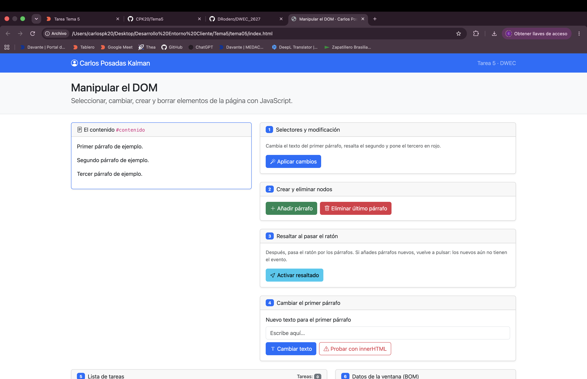
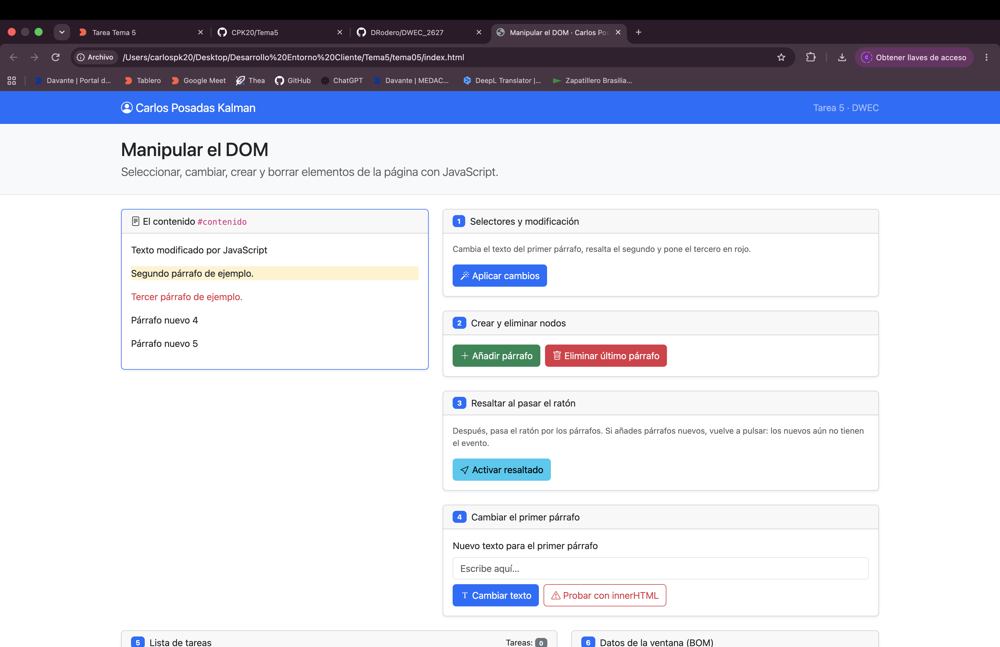
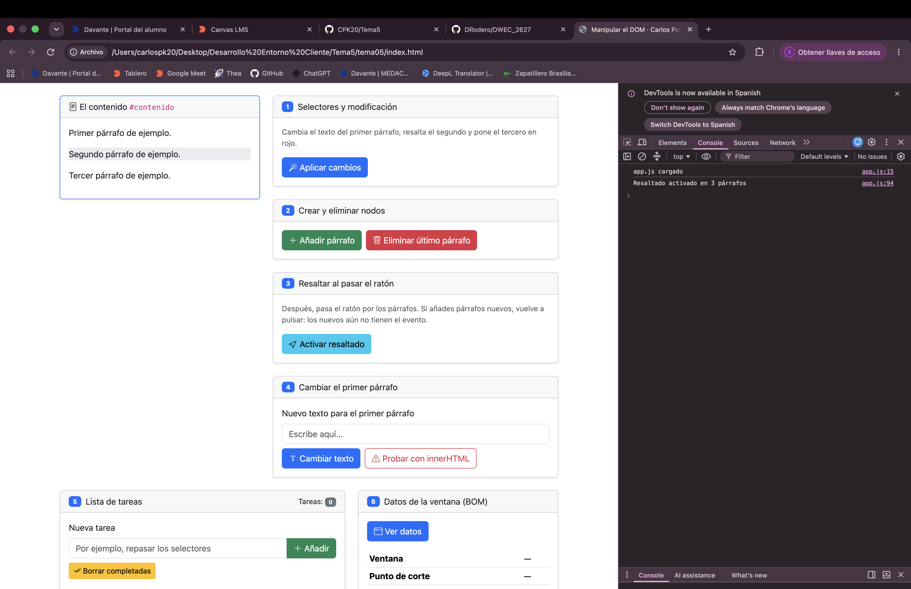
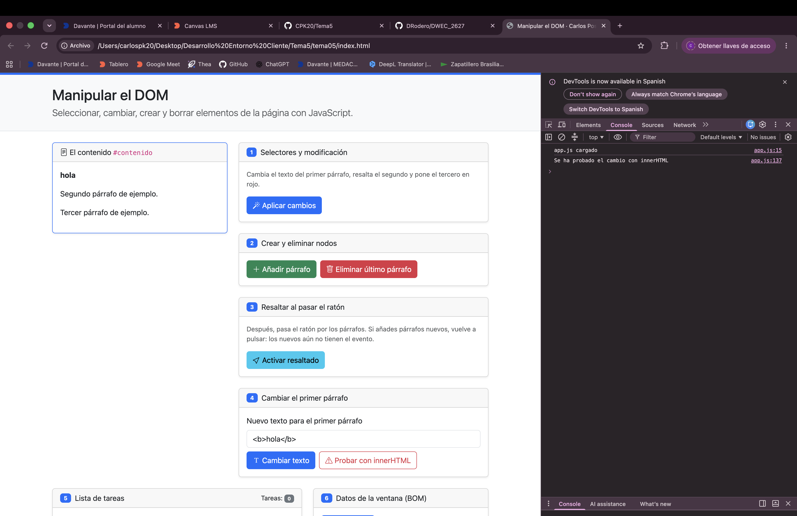
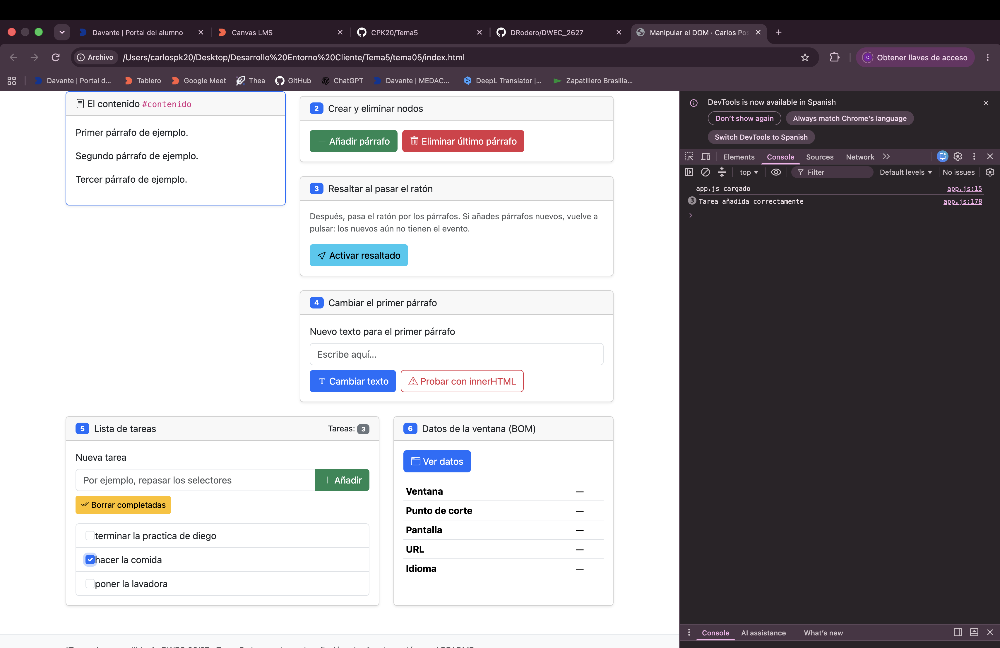
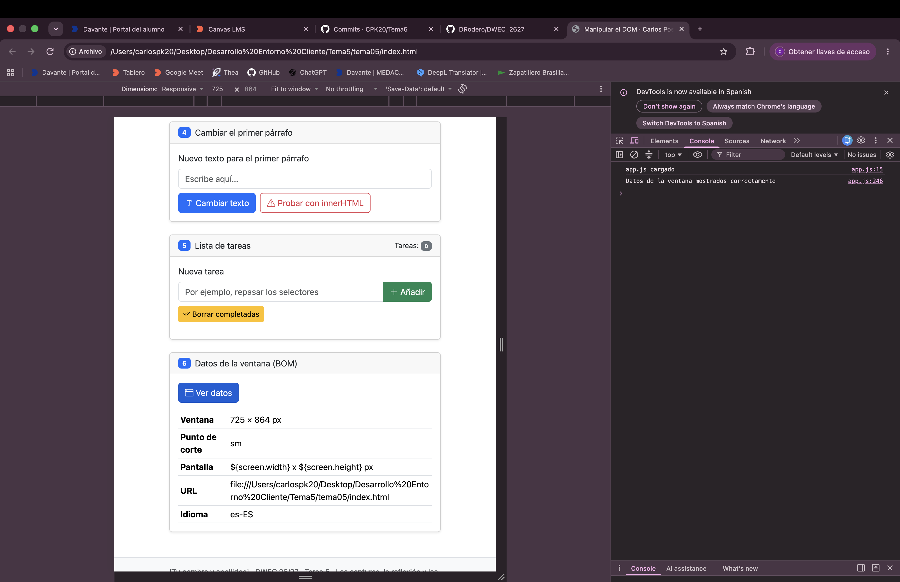

# Tarea 5 · Manipular el DOM

**Autor:** Carlos Posadas Kalman · Desarrollo Web en Entorno Cliente (DWEC) · 2.º DAW · Curso 2026-27

## Capturas

### a) La página recién cargada

### b) Ejercicios 1 y 2

En el ejercicio 1 he utilizado distintos selectores de JavaScript para modificar los tres párrafos. El primero se selecciona mediante getElementById() y se cambia su contenido con textContent. El segundo se selecciona mediante querySelector() y se resalta añadiendo la clase bg-warning-subtle. El tercero se selecciona mediante querySelectorAll() y se le añade la clase text-danger para mostrarlo en rojo.

En el ejercicio 2 he utilizado createElement() para crear nuevos párrafos y append() para añadirlos al contenedor. También he utilizado remove() para eliminar el último párrafo.

### c) Ejercicio 3: resaltado al pasar el ratón

Al pulsar el botón de activar resaltado y pasar el ratón por encima de un párrafo, este cambia su color de fondo gracias a la clase bg-body-secondary. Cuando el ratón sale del párrafo, se elimina esa clase y vuelve a su aspecto original.

Para conseguirlo he usado los eventos "mouseenter" y "mouseleave" junto con "classList.add()" y "classList.remove()".

### d) Ejercicio 4: `<b>hola</b>` con innerHTML

Al escribir <b>hola</b> y pulsar «Cambiar texto», aparece literalmente <b>hola</b> en el primer párrafo, porque textContent trata las etiquetas como texto normal.

### e) Ejercicio 5: la lista de tareas

En este ejercicio he creado una lista de tareas utilizando JavaScript. He añadido tres tareas mediante createElement() y append(), y cada una tiene una casilla de verificación de tipo checkbox.

### f) Ejercicio 6: los datos de la ventana en el móvil

En este ejercicio he utilizado el objeto window para obtener las dimensiones de la ventana del navegador y determinar el punto de corte de Bootstrap.

## Reflexión

La principal diferencia entre textContent e innerHTML es la forma en la que interpretan el contenido.
textContent introduce el texto literalmente, sin interpretar las etiquetas HTML.
En cambio, innerHTML interpreta las etiquetas y permite modificar la estructura HTML.
Por ejemplo, al escribir <b>hola</b> con textContent, aparecen las etiquetas en pantalla.
Con innerHTML, el navegador interpreta la etiqueta y muestra la palabra en negrita.
No es recomendable utilizar innerHTML directamente con contenido introducido por el usuario, ya que podría contener código malicioso.
Esto puede provocar ataques XSS, por lo que es más seguro utilizar textContent cuando solo necesitamos mostrar texto.

